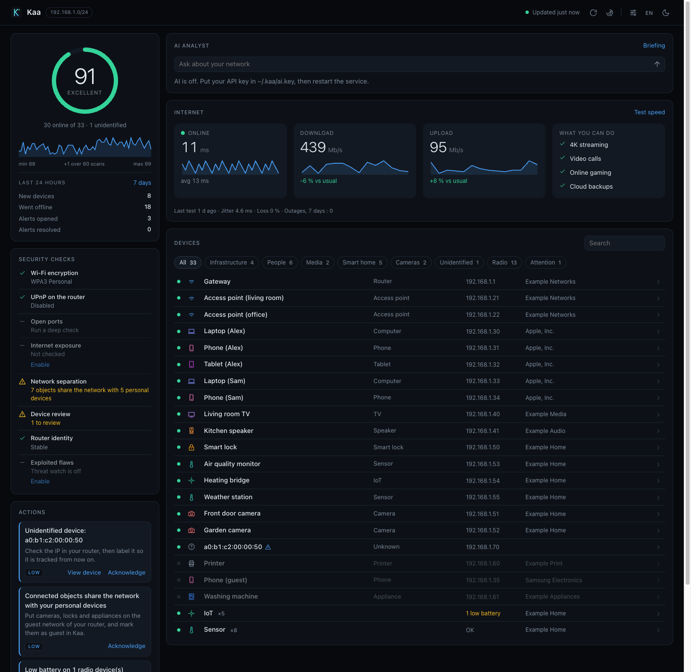
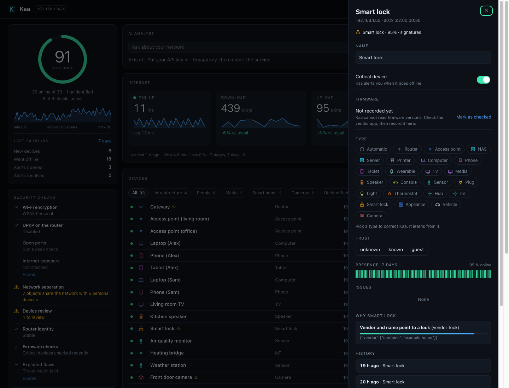
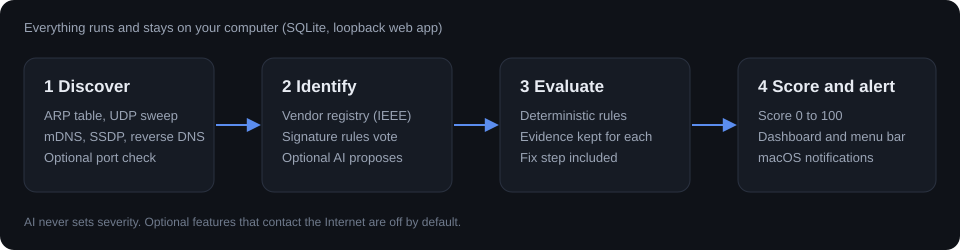

<p align="center"></p>

<h1 align="center">Kaa</h1>

<p align="center"><b>A home network security analyser that runs on your own computer.</b></p>

<p align="center"><a href="https://github.com/yanickimhof/kaa/actions/workflows/ci.yml"></a>  </p>

<p align="center"></p>

Kaa maps every device on your home network, recognises what each one is, checks the few things that really matter for security, and turns the result into a short list of actions. Everything is stored locally. Nothing is sent anywhere unless you switch an optional feature on.

## Features

| | |
|---|---|
| **Device map** | Every device with its type, vendor and name, found by passive discovery (ARP, mDNS, SSDP). Each identification shows the evidence behind it, and you can correct it: Kaa learns from your corrections. Radio devices read from the Tado and Netatmo clouds (opt in) appear alongside, with battery and signal. |
| **Security checks** | A compact checklist: Wi-Fi encryption, UPnP on the router, risky open ports, Internet exposure, network separation, devices to review, router identity, firmware check reminders, known exploited flaws. Each line is green, orange, acknowledged or not checked, and tells you what to do. |
| **Health score** | One number from 0 to 100 with its history. Deterministic: severity never comes from an AI. Acknowledging a finding does not raise the score; accepted risks are counted and shown next to it, with how many checks are active. |
| **Alerts** | New unknown device, router hardware address change (the signature of a man-in-the-middle attack), a critical device going offline, weak Wi-Fi, exposed services, and a device that opens a new port after Kaa first checked it. macOS notifications respect quiet hours. |
| **Known exploited flaws** | Matches your vendors and, when known, your exact models against the CISA KEV catalogue. Model level matches are shown first. |
| **Internet** | Live latency, download and upload trends compared with your usual values, and what your connection currently supports (4K, video calls, gaming, cloud backups). |
| **Presence** | For each device, seven days of presence hour by hour. |
| **AI analyst** | Optional. Ask questions about your network, get a briefing, or sort known exploited flaws by relevance. The model never receives MAC or IP addresses and never decides severity. |
| **Menu bar and service** | On macOS, a menu bar icon with a coloured status dot, and a background service that starts at login. |

<p align="center"></p>

Light and dark themes follow your system. The interface is available in English and French.

The interface is plain HTML, CSS and JavaScript: no framework and no external request. Its motion follows the fluid interface principles Apple presented at WWDC (not affiliated with Apple): the drawer follows your pointer one to one, can be grabbed while it moves, and a flick decides where it lands. It respects reduced motion, reduced transparency and increased contrast. See [docs/DESIGN.md](docs/DESIGN.md).

## How it works

<p align="center"></p>

1. **Discover.** A gentle sweep of your private network, then the operating system neighbour table.
2. **Identify.** Signature rules (YAML, easy to extend) vote on a device class. Agreeing rules reinforce each other. An optional model only proposes a type when no rule matches.
3. **Evaluate.** Deterministic rules in `findings.py` produce findings, each with its evidence and a fix.
4. **Score and alert.** Changes you need to know about become notifications.

More detail in [docs/ARCHITECTURE.md](docs/ARCHITECTURE.md).

## Install

```bash
pipx install git+https://github.com/yanickimhof/kaa
kaa update-data    # downloads the public vendor registry, once
kaa serve --open   # http://127.0.0.1:8473
```

Kaa needs Python 3.11 or later. Without `pipx`, install [uv](https://docs.astral.sh/uv/) and use `uv tool install git+https://github.com/yanickimhof/kaa`.

On macOS, keep it running from login with `kaa service install`. This also starts the menu bar icon.

To use Kaa like an app, open it in Chrome and choose Install Kaa (address bar or menu), or in Safari choose File, Add to Dock. It opens in its own window.

Try the interface without scanning anything: `python scripts/demo.py` serves synthetic data on port 8480.

## Commands

| Command | Does |
|---|---|
| `kaa serve` | web app and background scanner |
| `kaa scan [--ports]` | one scan from the terminal |
| `kaa devices` | list what Kaa knows |
| `kaa doctor` | check setup and scope |
| `kaa service install` | run in the background from login (macOS) |
| `kaa menubar` | macOS menu bar item |

Settings live in the web app (gear icon) and in `config.toml` inside Kaa's data folder, which `kaa doctor` prints.

## Privacy

Kaa listens on `127.0.0.1` only and scans only private networks. By default it makes two kinds of outbound connection: a one-off download of the IEEE vendor registry, and a small TCP connection to a public resolver (1.1.1.1, falling back to 9.9.9.9) every 15 seconds to measure Internet latency. Nothing is sent over them. Everything else is opt in:

| Feature | Contacts | Sends |
|---|---|---|
| Known exploited flaws | CISA | nothing (downloads the public catalogue) |
| Speed test | Cloudflare | test traffic |
| Internet exposure check | Cloudflare, Shodan InternetDB | your public IP address only |
| Tado and Netatmo | their cloud APIs | your own sign in, read only |
| AI analyst | the endpoint you configure | coarse device facts, no MAC or IP |

See [SECURITY.md](SECURITY.md) for the security model and [docs/AUDIT.md](docs/AUDIT.md) for the review notes.

## Contributing

Issues and pull requests are welcome. New device signatures are the easiest contribution. See [CONTRIBUTING.md](CONTRIBUTING.md).

## License

[MIT](LICENSE)
